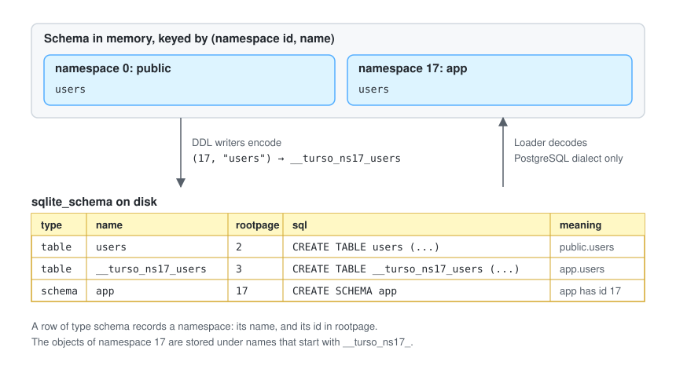
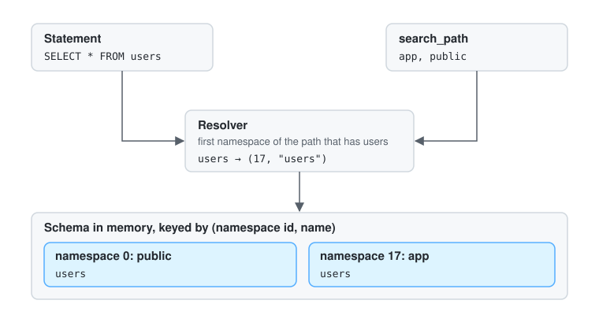

# Schema namespaces

This document describes how Turso manages schema namespaces: what a namespace is, how it is stored, how a written name resolves to one, how namespaces are created and dropped, and what the SQLite and Postgres frontends do with them. It is for people working on `core/` and `postgres/`.

## What is a namespace?

A namespace is a set of object names. For example, two tables can have the same table name if they are in different namespaces. In SQLite, two tables have the same name if a database is attached to the main database. In Postgres, you have the same thing if the tables belong to different Postgres schemas. In other words, a namespace is a unified view of the object names that are visible to a connection.

Every database has one namespace to begin with, the root namespace, whose id is `NamespaceId::ROOT`. It holds the objects of the database itself. An attached database is the root namespace of another database, so SQLite's "same name in two databases" is this mechanism. The main database can also have stored namespaces, each with its own tables, views, indexes, triggers and sequences; Postgres schemas are stored namespaces, so "same name in two schemas" is the same mechanism again.

The types live in `core/namespace.rs`:

- `NamespaceId` is the id of a namespace within one database's schema.
- `NamespaceRef` is a database id together with a namespace id. It is the place a name resolves to. `NamespaceRef::root_of(database_id)` is the root namespace of a database.
- `Namespace` is a name the connection knows, such as `main`, `aux`, `public` or `app`, together with the `NamespaceRef` it refers to.
- `Namespaces` is the connection's table of those names.

`Schema` in `core/schema.rs` is the catalog of one database. It keeps the objects of each namespace apart, and every accessor takes the namespace id first: `get_table(namespace, name)`, `get_indices(namespace, table)`, `get_view`, `get_sequence`, `triggers(namespace)`, and so on. An object is always looked up by `(NamespaceId, bare name)`. The bare name is the name the user wrote, `users`, never an encoded form. Nothing above the schema loader and the DDL writers knows how a stored namespace is written to disk.

## Namespace representation

The on-disk representation of namespaces extends the `sqlite_schema` table adding a `schema` type, which holds Postgres `CREATE SCHEMA` statements, similar to `table` holds `CREATE TABLE` statements, shown in the figure below.

A `schema` row records a namespace: its name in `name` and `tbl_name`, its id in `rootpage`, and `CREATE SCHEMA app` as its `sql`. No B-tree has that root: `rootpage` is an integer column that means nothing for a row without a B-tree, the way views and triggers store 0 there. A stored namespace exists while its row exists, so a schema can be empty.

The objects of a stored namespace share the one `sqlite_schema` with the objects of the root namespace, so their names encode the namespace. An object `users` of the namespace with id 17 is stored under the name `__turso_ns17_users`. The `name` and `tbl_name` columns of its row use that name, and so does the SQL text of the row: the loader reads `CREATE TABLE __turso_ns17_users (...)` and decodes it to table `users` of namespace 17. Views, indexes, triggers and sequences are named the same way. Encoding the id rather than the name means the stored names of two schemas can never collide, whatever the schemas are called: `app."sub.t"` and `"app.sub".t` are different tables, and `public."app.x"` is not a table of schema `app`.

The objects the engine derives from a table also use the stored name and live in the root namespace: the autoincrement sequence of `app.users` is `__turso_internal_autoincrement___turso_ns17_users`, the backing table of a sequence is named after the stored sequence name, and the rows of `sqlite_sequence` and `sqlite_stat1` name the stored table.

The encoding is confined to two places:

- The loader decodes. `handle_schema_row` and `populate_indices` in `core/schema.rs` call `parse_stored_name`, a `schema` row names its namespace, and `load_sqlite_stat1_row` decodes the `tbl` column.
- The DDL writers encode. `Resolver::stored_name(namespace, name)` is the name to write into a schema row, and `Resolver::name_in_sql` is the name to write into stored SQL text. CREATE TABLE, CREATE TABLE AS, CREATE INDEX, CREATE VIEW, CREATE TRIGGER, CREATE SEQUENCE and ALTER TABLE use them.

Only a database of a dialect that stores namespaces decodes these names, reads `schema` rows, or refuses `__turso_ns...` as a user name. `Dialect::stores_namespaces` says so; it is true for the Postgres dialect and false for SQLite, and the schema keeps the answer for its loader. SQLite allows a table called `__turso_ns1_t`, and a database made by SQLite may hold one, so under the SQLite dialect such a name is the name of an ordinary object of the root namespace and nothing is decoded. A database is always opened with the dialect that made it, so a Postgres database never reads its stored names as plain ones.

Limits of the format:

- VACUUM is not supported for a database that has `schema` rows, since it recreates objects from their SQL and would give the namespaces new ids.
- The MVCC logical log and the sync engine carry table, index, view and trigger rows only, so a `schema` row is not replicated.
- Databases with schemas in `turso-postgres-schema-*.db` files from earlier versions are not read and are not migrated.

## Object name resolution

Object name resolution happens through a connection, which has a set of namespaces represented by the `Namespaces` in-memory data structure.

The figure shows `public.users` shadowed by `app.users`: with `app` first on the search path, the bare name `users` resolves to namespace 17.

`Namespaces` maps each name to a `NamespaceRef`. `main` and `temp` always exist and refer to the roots of the main and temp databases. ATTACH adds a name for the root of the attached database. The Postgres frontend adds `public` as a second name for the root of main, and `Connection::namespaces()` adds every stored namespace of the main database under its name.

The resolver (`core/translate/emitter/mod.rs`) turns a written name into a `NamespaceRef`:

- A qualified name, `app.users`, is looked up in the namespace called `app`.
- An unqualified name, `users`, is looked up through the search order, a list of namespaces. With no search path the order is main, then the attached databases by id. With a search path it is the namespaces of the names that exist, each once, so `public` and `app` can both be in the order although both are in the main database. The first namespace of the order is where CREATE puts an object whose name has no namespace. Temp is not in the list: it comes before the list when the connection has a temp database.
- The body of a view or trigger resolves names written without a namespace in the namespace of the view or trigger, not in the search path of the session that runs it.

Once resolved, the namespace travels with the object through the planner and into the bytecode:

- `JoinedTable` and `OuterQueryReference` in `core/translate/plan.rs` have a `namespace: NamespaceRef`, so two tables named `users` in two schemas are different tables in a plan.
- The opcodes that change the schema in memory (`DropTable`, `DropView`, `DropIndex`, `DropTrigger`, `DropSequence`, `DropNamespace`, `RenameTable`, `DropColumn`, `AddColumnData`, `AlterColumnData`) and the sequence opcodes have a `namespace: NamespaceId` next to the database id.
- A foreign key records the namespace of its parent table (`ForeignKey::parent_namespace`), so a table of one schema can reference a table of another, and the checks that find the foreign keys referencing a table scan every namespace.
- Analyze statistics are keyed by `(NamespaceId, table name)`.

Places that address an internal table like `sqlite_schema` name `NamespaceId::ROOT` explicitly.

## Creating and dropping namespaces

`CREATE SCHEMA app` and `DROP SCHEMA app` are statements of core (`translate_create_schema` and `translate_drop_schema` in `core/translate/schema.rs`), accepted only when the dialect stores namespaces.

CREATE SCHEMA picks the next id, one more than the largest id that a stored namespace or any object stored under a namespace has, so an id whose objects are still stored is never given out again. It inserts the `schema` row, reparses it so the schema in memory names the namespace, and bumps the schema cookie. The cookie change makes the namespace visible to every connection of the database, and the row is deleted again if the transaction rolls back.

DROP SCHEMA deletes the row and forgets the name with the `DropNamespace` opcode. The objects stored under the id stay until they are dropped, so the caller drops them first; the id is not reused while any of them remain.

`Connection::create_stored_namespace(name)` and `Connection::drop_stored_namespace(name)` run these statements for a frontend that creates schemas from its own syntax.

## SQLite frontend

Only root namespaces exist, so every `NamespaceRef` is the root of some database, the search order is main, then the attached databases, and every lookup finds what it found when the catalog was keyed by database alone. `CREATE SCHEMA` is refused, `schema` rows are skipped, and a name that looks like a stored name is an ordinary name.

## Postgres frontend

The frontend (`postgres/frontend/session.rs`) maps the statements:

- `CREATE SCHEMA app` creates the stored namespace `app`. Its elements, if any, are created in it.
- `DROP SCHEMA app [CASCADE]` lists the objects of the namespace through the catalog, drops them, then drops the namespace. Without CASCADE a namespace that still has objects is refused.
- A foreign key that names a table with a schema is rewritten to the table's stored name before the statement is translated, because the stored text names the table as it is stored. A foreign key to another database is refused.
- A missing namespace is reported as `schema "x" does not exist`.

`pg_namespace` lists the schemas. `public` has OID 2200, and the OID of a stored namespace is 16384 plus its id, so it stays the same while other schemas come and go. `pg_class`, `pg_tables`, `pg_indexes`, `pg_sequences` and the other catalogs iterate every namespace of the main database and report each object under its schema. Attached databases are not schemas and are not listed.

Limits of the frontend:

- Materialized views cannot be created in a schema.
- `ALTER TABLE RENAME` rewrites the table's own rows but does not rewrite references written without a schema inside the view and trigger bodies of the same schema on disk.
- A table in a schema whose column default calls a sequence stores the translated statement text rather than the original, so the sequence name is not derived from the stored table name when the schema loads.
